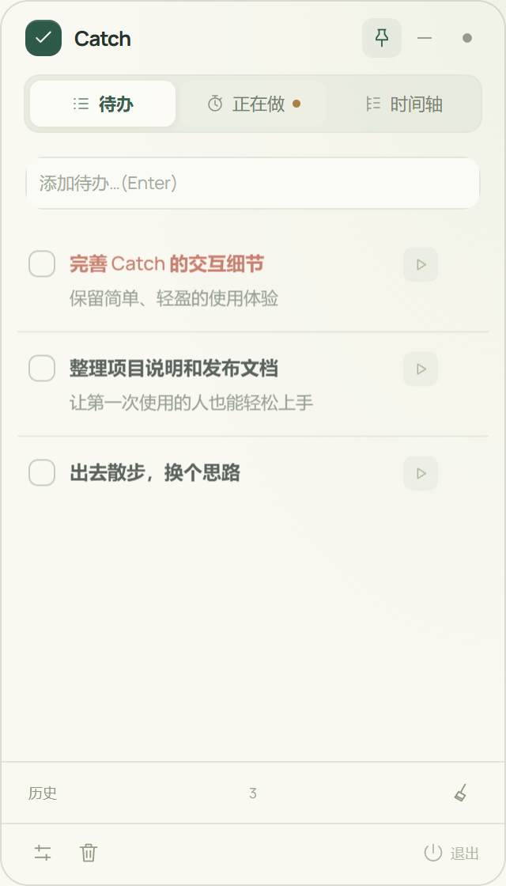
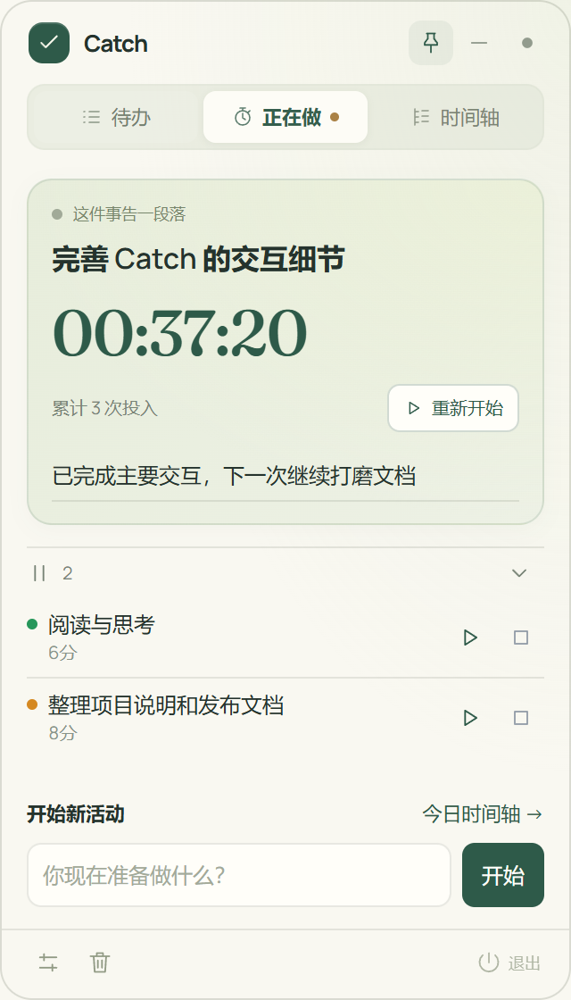
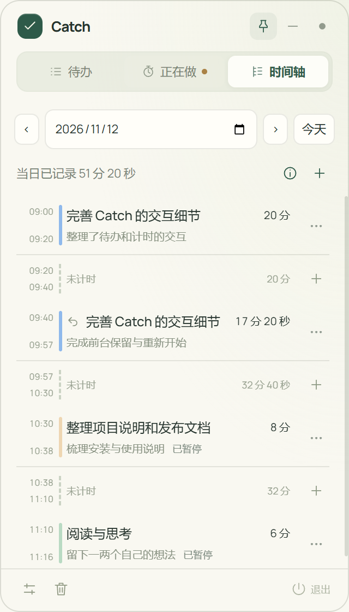

<div align="center">
  
  <h1>Catch</h1>
  <p><strong>悬浮在桌面的待办与计时工具，让计划和投入都看得见。</strong></p>
  <p>Windows 10 / 11 · 64 位 · 本地保存 · 无需注册</p>
  <p>
    <a href="https://github.com/puuchi/Catch/releases/download/v2.0.0/Catch-2.0.0-x64-win.exe"></a>
    <a href="https://puuchi.github.io/Catch/"></a>
    <a href="https://github.com/puuchi/Catch/releases/download/v2.0.0/Catch-2.0.0-x64-win.zip"></a>
    <a href="#快速上手"></a>
  </p>
  <p>
    <a href="https://github.com/puuchi/Catch/releases/latest"></a>
    <a href="LICENSE"></a>
    <a href="#下载与安装"></a>
  </p>
</div>

<p align="center">
  <a href="https://puuchi.github.io/Catch/"></a>
  <a href="https://puuchi.github.io/Catch/"></a>
  <a href="https://puuchi.github.io/Catch/"></a>
</p>
<p align="center"><sub>点击图片或<a href="https://puuchi.github.io/Catch/">在线体验</a>，打开部分功能的交互演示；完整体验请下载桌面版。图片与演示均使用示例数据。</sub></p>

准备写一份方案，先把它记成待办。开始时点一下播放键，中途切去处理别的事就暂停或切换，回来继续，把本次进展留下。一天结束，再从时间轴回看自己真正投入了什么。

Catch 把这几个动作放在同一个桌面小窗里：**记下要做的事，专心做眼前的事，回看已经做过的事。**

## 用 Catch 做什么

- **随手记待办** — 记录要做的事，补充备注、标记加急或设定截止日期，完成后可回看历史。
- **一次专心一件事** — 一个事项在前台计时，其他事项可以暂停、稍后继续；也可以不建待办，直接开始计时。
- **留住每次进展** — 写下本次做到了哪里，用“下一步”开始同一事项的下一次投入。
- **看见时间的去向** — 按日期查看时间轴、展开事项详情，支持补录和修正记录。
- **收起是一株小绿芽** — 暂时用不到窗口时，收起为可拖动的绿芽；计时状态会通过动画反馈。

## 下载与安装

适用于 **Windows 10 / 11，64 位（x64）**。日常使用无需安装 Node.js，也无需注册账号或联网。

| 版本 | 使用方式 |
| --- | --- |
| **[Windows 安装版](https://github.com/puuchi/Catch/releases/download/v2.0.0/Catch-2.0.0-x64-win.exe)** · 推荐 | 下载 `.exe`，双击按提示安装，再从桌面或开始菜单打开 Catch。 |
| **[免安装版](https://github.com/puuchi/Catch/releases/download/v2.0.0/Catch-2.0.0-x64-win.zip)** | 下载 `.zip`，完整解压后运行 `Catch.exe`。移动时请保留整个解压目录。 |

其他版本和校验文件见 [Releases](https://github.com/puuchi/Catch/releases)。

> 当前安装包尚未签名，Windows 可能显示“未知发布者”或信誉提示。请核对下载来源，需要时对照 Release 中的 `SHA256SUMS.txt` 检查文件。

## 快速上手

1. **记下来**：在待办输入框输入内容，按 Enter 创建；也可以先补充备注、紧急标记和截止日期。
2. **开始做**：点击待办旁的播放按钮开始计时，或在“正在做”中直接输入事项名称并开始。
3. **留个进展**：输入本次进展并按 Enter 保存；需要分步骤记录时，点击“下一步”。
4. **回头看看**：在“时间轴”切换日期、查看投入记录，需要时补录或修改。

**结束计时与完成待办是两个独立动作。** 结束投入后，是否勾选完成由你决定。

| 想做什么 | 怎么操作 |
| --- | --- |
| 修改待办 | 点击待办文字，编辑后确认；Esc 取消。 |
| 暂停或继续 | 使用“正在做”中的暂停按钮，或后台事项的继续按钮。 |
| 收起或展开 | 点击右上角圆点收起为绿芽；单击绿芽展开，拖动可改变位置。 |
| 找回误删记录 | 从窗口底部打开回收站，恢复待办、事项或单次投入。 |
| 退出应用 | 点击底部“退出”，或右键绿芽选择“关闭”；计时中会询问是否暂停并退出。 |

## 数据与常见问题

<details>
<summary><strong>我的记录存在哪里？</strong></summary>

记录保存在本机。按 Win + R，粘贴以下路径即可打开数据目录：

```text
%APPDATA%\float-todo
```

这个目录名为兼容旧版保留。主要文件为 `todos.json`、`archive.json`、`activity-log.json` 和 `config.json`，分别保存待办、完成历史、投入记录和设置。数据与应用安装目录分开存放。

</details>

<details>
<summary><strong>怎样备份和更新？</strong></summary>

先正常退出 Catch，再复制整个数据目录进行备份。更新时退出旧版本，然后安装新版本或换用新的完整解压目录。当前没有自动更新。

卸载配置不删除用户数据；移动应用文件夹也不会搬走数据目录。不要让两个版本同时写同一份数据，也不要在应用运行中手工修改 JSON 文件。

</details>

<details>
<summary><strong>锁屏、睡眠或意外关闭后，计时会怎样？</strong></summary>

锁屏和睡眠会暂停计时。意外关闭后，应用会恢复到最近保存的检查点并暂停，避免把离线时间全部计入。最后一小段未保存的投入可能需要在时间轴补录或修正。

主动退出时若保存失败，应用会提示并保留窗口，方便检查后重试。

</details>

## 从源码运行

需要 **Node.js 22.12+**，推荐 Node.js 24；首次安装开发依赖需要联网。

```powershell
git clone https://github.com/puuchi/Catch.git
cd Catch
npm ci
npm start
```

`npm start` 会构建界面资源并启动 Electron。

| 命令 | 用途 |
| --- | --- |
| `npm run check` | 后端与契约类型检查、模块依赖检查。 |
| `npm test` | 业务规则、存储故障和恢复测试。 |
| `npm run test:electron` | 使用隔离数据运行 Electron 界面回归。 |
| `npm run dist` | 生成 Windows x64 安装版、ZIP 和 SHA-256 校验文件，输出至 `dist/`。 |

测试使用独立临时数据目录。覆盖范围与环境限制见 [验证记录](docs/VALIDATION.md)。

## 代码结构

Catch 使用 **Electron + JavaScript**，数据保存在本地 JSON 文件中。业务规则、应用操作、文件存储、桌面窗口与界面按职责分开，业务写入统一由主进程提交。

进一步了解：[架构说明](docs/CATCH_ARCHITECTURE.md) · [业务术语](GLOSSARY.md) · [架构决策](docs/adr/0001-local-modular-architecture.md)。

## 许可与致谢

原创代码采用 [MIT 许可证](LICENSE)。项目来源、授权贡献，以及字体、绿芽和运行时的单独许可，详见 [第三方说明](THIRD_PARTY_NOTICES.md)。
