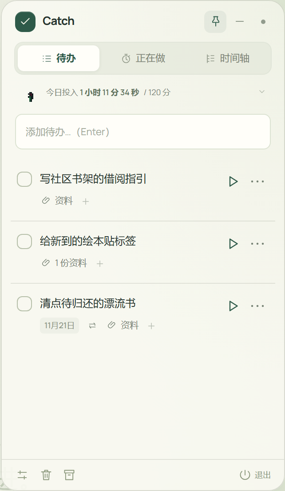
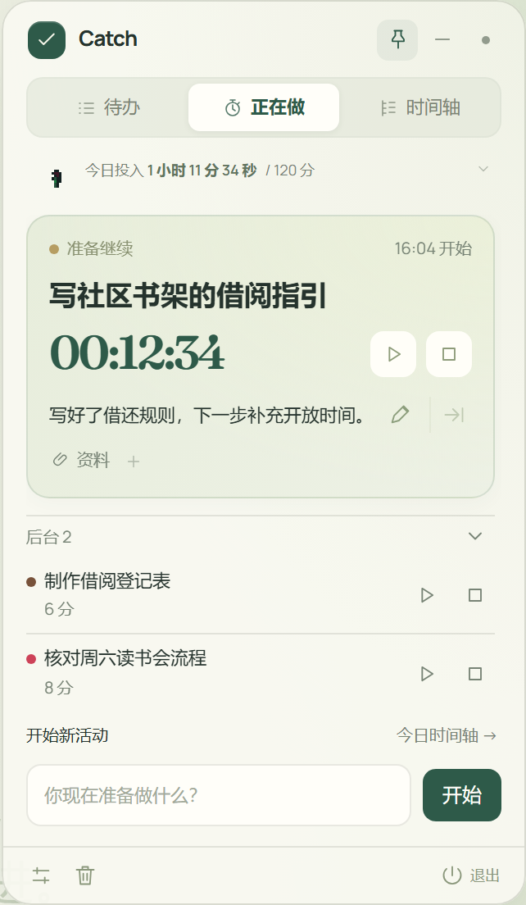
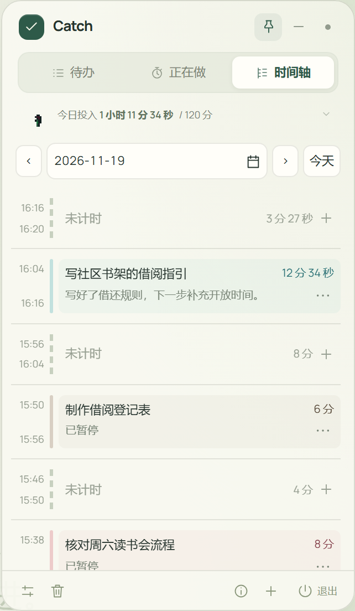
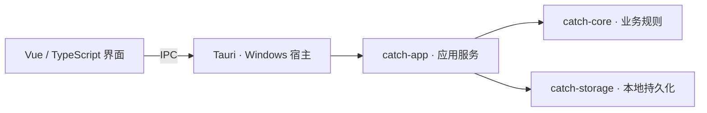

<div align="center">
  
  <h1>Catch</h1>
  <p><strong>悬浮在桌面的待办与计时工具，让计划和投入都看得见。</strong></p>
  <p>Windows 10 / 11 · 64 位 · 本地保存 · 无需注册</p>
  <p>
    <a href="https://github.com/puuchi/Catch/releases/download/v3.0.0/Catch_3.0.0_x64-setup.exe"></a>
    <a href="https://puuchi.github.io/Catch/"></a>
    <a href="#快速上手"></a>
  </p>
  <p>
    <a href="LICENSE"></a>
    <a href="#下载与安装"></a>
  </p>
</div>

<p align="center">
  <a href="https://puuchi.github.io/Catch/"></a>
  <a href="https://puuchi.github.io/Catch/"></a>
  <a href="https://puuchi.github.io/Catch/"></a>
</p>
<p align="center"><sub>截图来自与桌面版共用界面的 Tauri 演示，使用示例数据。</sub></p>

准备写一份方案，先把它记成待办。开始时点一下播放键，中途切去处理别的事就暂停或切换，回来继续，把本次进展留下。一天结束，再从时间轴回看自己真正投入了什么。

Catch 把这几个动作放在同一个桌面小窗里：**记下要做的事，专心做眼前的事，回看已经做过的事。**

## 用 Catch 做什么

- **随手记待办** — 记录要做的事，补充备注和截止日期，也可以设置重复。
- **把相关资料放在一起** — 给待办或事项关联文件、文件夹和网页，从记录里直接打开。
- **一次专心一件事** — 一个事项在前台计时，其他事项可以暂停、稍后继续。也可以直接开始计时。
- **留住每次进展** — 写下本次做到了哪里，用“下一步”开始同一事项的下一次投入。
- **看见时间的去向** — 按日期查看时间轴、展开事项详情，支持补录和修正记录。
- **看着植物长大** — 在「今日投入」选一株植物，它会随有效投入逐步成长。收起窗口后，植物留在桌面上。

## 下载与安装

适用于 **Windows 10 / 11，64 位（x64）**。双击 `.exe` 安装包，再从开始菜单打开 Catch。系统缺少 WebView2 时，首次安装会联网下载。安装后可以离线使用，无需注册账号。

- [下载 Catch v3.0.0 Windows x64 安装包](https://github.com/puuchi/Catch/releases/download/v3.0.0/Catch_3.0.0_x64-setup.exe)
- [SHA-256 校验文件](https://github.com/puuchi/Catch/releases/download/v3.0.0/SHA256SUMS.txt) · [更新说明](https://github.com/puuchi/Catch/releases/tag/v3.0.0)

> 当前安装包尚未签名，Windows 可能显示“未知发布者”或信誉提示。请核对下载来源，需要时对照 Release 中的 `SHA256SUMS.txt` 检查文件。

## 快速上手

1. **记下来**：在待办输入框输入内容，按 Enter 创建。也可以先补充备注、紧急标记和截止日期。
2. **开始做**：点击待办旁的播放按钮开始计时，或在“正在做”中直接输入事项名称并开始。
3. **留个进展**：输入本次进展并按 Enter 保存。需要分步骤记录时，点击「下一步」。
4. **回头看看**：在“时间轴”切换日期、查看投入记录，需要时补录或修改。

结束与待办关联的计时时，可以选择「仅结束」或「结束并完成待办」。

| 想做什么 | 怎么操作 |
| --- | --- |
| 修改待办 | 双击待办文字，编辑后确认。按 Esc 取消。 |
| 关联资料 | 点击待办或事项的「资料」旁的加号。 |
| 设置重复 | 打开待办的三点菜单，选择「设置重复」。 |
| 暂停或继续 | 使用“正在做”中的暂停按钮，或后台事项的继续按钮。 |
| 收起或展开 | 点击右上角圆点收起为悬浮植物。单击植物展开，拖动可改变位置。 |
| 找回误删记录 | 从窗口底部打开回收站，恢复待办、事项或单次投入。 |
| 退出应用 | 点击底部「退出」，或右键悬浮植物选择「退出」。计时中会询问是否暂停并退出。 |

## 数据与常见问题

<details>
<summary><strong>我的记录存在哪里？</strong></summary>

记录保存在本机。按 Win + R 后粘贴下面的路径即可打开数据目录。

```text
%APPDATA%\io.github.puuchi.catch.next
```

待办、归档、投入记录、植物成长与设置都保存在这个目录，数据与应用安装目录分开存放。

</details>

<details>
<summary><strong>怎样备份和更新？</strong></summary>

先正常退出 Catch，再复制整个数据目录进行备份。更新时双击新安装包。若需要回退到仅支持旧回执格式的程序，应同时恢复升级前的完整数据目录。[回执与迁移说明](docs/FINISH_REPLAY.md)

</details>

<details>
<summary><strong>锁屏、睡眠或意外关闭后，计时会怎样？</strong></summary>

锁屏和睡眠会暂停计时。意外关闭后，应用会恢复到最近保存的检查点并暂停，避免把离线时间全部计入。最后一小段未保存的投入可能需要在时间轴补录或修正。

主动退出时若保存失败，应用会提示并保留窗口，方便检查后重试。

</details>

## 从源码运行

需要 Windows x64、**Node.js 24**、当前稳定版 Rust、Visual Studio C++ Build Tools（含 Windows SDK）和 WebView2。首次安装开发依赖需要联网。

```powershell
git clone https://github.com/puuchi/Catch.git
cd Catch
npm.cmd --prefix frontend ci
.\tools\desktop.ps1 -Action dev
```

开发脚本默认将数据写入 `artifacts/catch-next-data/`。

| 命令 | 用途 |
| --- | --- |
| `npm.cmd --prefix frontend run check` | 检查 Vue 和 TypeScript 类型。 |
| `npm.cmd --prefix frontend test` | 运行界面逻辑和 Rust/TypeScript 接口契约测试。 |
| `cargo test --workspace --locked` | 测试 Rust 业务规则、存储和故障恢复。 |
| `.\tools\desktop.ps1 -Action pack` | 构建 Windows NSIS 安装包，默认输出到 `artifacts/tauri-next-target/release/bundle/nsis/`。 |

## 架构

Catch 用 Vue 和 TypeScript 构建界面，由 Tauri 接入 Windows 窗口和系统事件。Rust 维护计时、待办和植物成长的状态，并把数据写到本机。



- **收起窗口，计时继续。** 应用先保存界面草稿，再释放主 WebView。独立的 Win32 窗口显示悬浮植物，Rust 继续计时。点开植物时，Catch 重建界面并恢复草稿和页面位置。[窗口交接实现](src-tauri/src/main.rs)
- **一次确认，一起保存。** 点「结束并完成待办」后，最后进展、计时结束、待办完成及相关重复规则和请求回执一起提交。写入中断时，应用会先恢复事务。回执也能在重启后防止同一个请求被重复执行。[回执与故障恢复](docs/FINISH_REPLAY.md)

网页演示共用桌面版的 Vue 组件和样式，在浏览器里使用独立的示例数据。旧版 Electron 源码和构建说明可在 [v2.0.0 标签](https://github.com/puuchi/Catch/tree/v2.0.0) 查阅。[网页演示实现](site/README.md)

## 许可与致谢

原创代码采用 [MIT 许可证](LICENSE)。项目来源、授权贡献，以及字体、绿芽和运行时的单独许可，详见 [第三方说明](THIRD_PARTY_NOTICES.md)。
