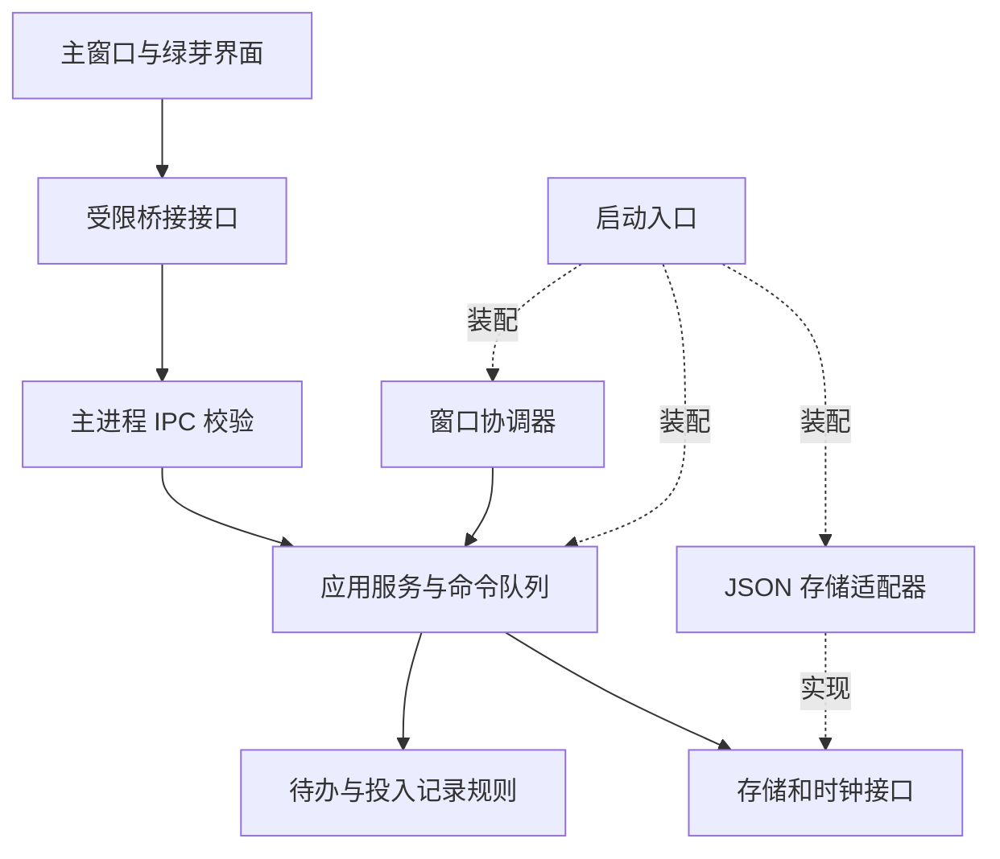

# Catch 架构说明

更新日期：2026-11-13。状态：2.0.0 当前源码已实施；分发成品状态与限制见 [验证记录](VALIDATION.md)。范围：本地 Electron 桌面应用与静态交互演示网站。

架构质量以可验证结果衡量：业务能脱离窗口测试；一次状态变化只有一个权威写入点；失败不伪装成成功；新功能可在所属模块内完成；代码来源能追溯。目录层级本身不是验收结果。

## 1. 职责与依赖

采用模块化单体。业务分为待办、投入记录、展示查询、偏好设置；桌面窗口与界面是业务的使用者。实际源码中，时间轴查询是 `domain/tracking/time.js` 的纯投影函数，UI 直接使用，不额外创建无实际职责的查询服务。



图中实线表示调用关系；业务服务只依赖接口，运行时实现由启动入口注入。

| 部分 | 负责 | 不得承担 |
|---|---|---|
| 领域规则 | 待办状态、事项/投入关系、计时转换、时间冲突等 | DOM、Electron、磁盘读写、弹窗 |
| 应用服务 | 执行命令、调用领域规则、提交数据、产生已提交快照 | HTML 拼接、窗口坐标算法 |
| 基础设施 | JSON 读写、备份、恢复、旧版本兼容 | 决定结束事项是否完成待办 |
| 桌面层 | 启动、单实例、窗口切换、IPC、锁屏睡眠、退出协调 | 在事件回调内自行修改业务文件 |
| 界面层 | 组件、草稿、焦点、交互反馈、展示订阅 | 独立维护一份可写业务数据库 |
| 契约 | 明确命令、查询、快照、错误和订阅范围 | 暴露任意路径读写、任意 IPC 通道 |

实现目录按实际职责创建：时钟、ID 和存储接口通过构造参数及 JSDoc 声明；旧格式兼容在存储适配器中，不另建空的 ports/compatibility 目录。

```text
src/
  bootstrap/                 唯一装配入口
  domain/
    todos/                   待办规则
    tracking/                事项、投入、时间约束
  application/
    todos/                   待办与归档用例
    tracking/                开始、暂停、继续、结束、进展和回收用例
  infrastructure/
    persistence/             文件保存、备份和恢复
  desktop/                   窗口协调、IPC、生命周期
  contracts/                 跨边界数据与运行时校验
  preload/                   主窗口和绿芽各自的有限接口
  ui/
    todos/ tracking/ trash/ sprout/
    shared/                  实际复用的控件、主题变量
```

依赖约束通过检查执行：domain 不导入上层、Node 或 Electron，也不读取全局 window/document；application 不导入 desktop、ui、具体存储；ui 不导入 Node/Electron；模块通过明确入口交互，不访问另一个模块内部文件；禁止循环依赖。共有文件只收容已被实际复用的能力。

## 2. 数据所有权与业务边界

术语见根目录 [GLOSSARY.md](../GLOSSARY.md)。内部新代码采用 Matter/Session/Interval，旧文件中的 `activities`、`segments` 由兼容层映射，不为命名变更重写用户数据。

| 数据 | 唯一所有者 | 关系与规则 |
|---|---|---|
| 待办、完成历史、待办回收记录 | 待办模块 | 完成与归档独立于计时；历史是已完成待办的查询视图 |
| 事项、单次投入、有效时间段、进展及其回收记录 | 投入记录模块 | 同时至多一个前台事项；切换同时关闭旧投入并开始新投入 |
| 时间轴 | 查询层 | 从投入记录推导，不保存第二套可编辑时间记录 |
| 综合回收站 | 查询层与应用协调 | 聚合两类所有者的结果，恢复/永久删除交回原所有者 |
| 窗口位置、透明度等偏好 | 偏好存储与桌面层 | 写失败不改变业务记录，界面显示未保存状态 |
| 编辑草稿、展开状态、焦点 | 相应 UI 模块 | 草稿不覆盖已提交业务状态 |

新领域模型以 Session 的 Interval 集合为有效时间来源；旧格式同时保存的事项 `segments` 仅由兼容层派生并核验，不能由两处独立修改。

结束事项不会自动完成待办；一个待办可以关联多个历史事项；暂停后继续产生新投入；“下一步”结束本次并开始下一次；删除待办不级联删除时间记录。结束后“重新开始”沿用事项 ID、颜色和待办关联，新增一次投入，保留历史进展与累计时长，不把结束到重启之间的时间计入。

业务上同时至多一个事项正在计时。界面的前台卡片另外保留展示选择：暂停或结束后留在原位，开始或继续另一个事项时再替换；下方暂停列表排除当前卡片，避免重复显示。这项展示规则在 `ui/tracking/foreground.js` 中由软件与网页共同使用。

## 3. 一次写操作如何完成

以从待办启动事项为例：

1. UI 发出具有明确参数的命令，保留当前草稿，按钮进入等待状态。
2. IPC 校验发送窗口、命令类型、字段和大小；应用服务确认待办仍存在且可启动。
3. 主进程命令队列确定执行顺序，读取权威状态；领域规则计算新状态，包括暂停原前台事项。
4. 存储成功后才切换内存中的已提交状态，推进对应模块的 revision。
5. 向主窗口和绿芽发布相应快照；UI 清除等待状态。计时数字的本地刷新不触发每秒磁盘保存。

普通业务写失败：保留上一份已提交状态，保留输入草稿，返回可展示的错误。遇到提交结果不确定的存储故障时，暂停后续写入并重新读取/恢复，不简单声称已回滚。

锁屏/睡眠/关机是特别路径：立即停止界面继续累计时间；若持久化失败，保留明确的未保存状态并限制后续计时命令。绝不能在保存失败后继续显示为正常计时。显式退出保存失败则阻止退出并提示；系统强制结束无法保证拦截，依赖已落盘检查点恢复。

当前主进程是唯一业务写入者。单实例锁、退出流程、检查点都服从同一套写入协调；设置写入可合并，退出前冲刷。读取可以使用已提交快照，无需每次阻塞文件读取。

## 4. 接口、状态和错误

- 使用 JavaScript；领域、应用、存储、桌面、preload 与契约纳入 JSDoc/checkJs 检查，DOM 界面通过 Electron 和浏览器回归核查。跨进程输入仍做运行时校验，静态类型不是信任边界。
- 使用窄接口，例如 `todos.create`、`todos.complete`、`tracking.start`、`tracking.pause`、`timeline.queryDay`；不向 UI 提供任意 IPC 发送器或泛用文件 API。
- 命令返回成功值或结构化错误。错误码区分 `VALIDATION`、`CONFLICT`、`STORAGE_FAILURE`、`UNSUPPORTED_DATA_VERSION` 等，用户文案由界面映射；内部日志不默认记录待办文本和进展内容。
- 模块快照携带自身 revision。状态订阅支持释放；窗口重载后先订阅、获取快照并按 revision 丢弃旧结果；发现版本缺口时重新查询。主窗口和绿芽不互相直接推送业务真相。
- 编辑命令携带期望版本；冲突时保留草稿并刷新，不用旧表单覆盖新状态。旧 API 适配器在迁移阶段显式标记限制，最终不得绕过校验与提交顺序。
- 同一进程生命周期内按 requestId 和参数指纹识别重复命令，缓存实际结果；相同 ID 不同参数拒绝。缓存过期或跨进程重启后，不自动重发非幂等命令，先查询实际状态。首版不宣称跨崩溃的 exactly-once 保证。

## 5. 存储、恢复与数据兼容

首轮继续兼容 `%APPDATA%\float-todo` 与既有活动 JSON。存储接口描述业务提交能力，不暴露任意文件路径；文件名、备份和 schema 转换仅在存储层。

单文件写入采用临时文件、刷新、替换及备份，保留已验证的现有能力并测试 Windows 文件占用和失败路径。原子替换不等于断电下绝对耐久，也不等于跨文件事务。坏文件保留，未知高版本拒绝写入，不能回退成空文档继续覆盖。

待办与归档目前分属两个文件，首轮采用专用、可恢复的归档流程：在串行写入边界内，先可靠记录操作 ID、待迁移条目及预期版本，再按 ID 幂等写入归档，随后从待办中移除相应条目，最后清理操作记录。启动时先恢复未完成操作再开放写入；对外只发布完成后的快照。恢复失败保留原件并停止写入，不能静默跳过。此流程只承诺受支持单实例写入条件下的可恢复性，旧版程序或外部手工编辑不能同时写这些文件。

归档协议是实现前必须验证的风险点：在每个写入边界注入中断，证明不丢数据、恢复可重试且不会重复归档。若无法以小而清晰的实现通过测试，就单独调整存储方案并更新 ADR，不扩展出一套通用文件数据库。

备份导出需要在写入协调边界内获取一致快照。首次迁移先备份，验证 ID、数量、关联及投入总时长；保留损坏原件和版本信息。活动 schema、数据目录迁移和 Electron 升级分别处理。

## 6. 桌面与 UI

窗口协调器管理主窗口/绿芽的可见状态、正在切换、退出中的状态及失败恢复。窗口切换必须等待目标内容可显示；生命周期事件不能散落到业务模块。复用已授权的窗口边界和本地绘制交接能力。

每个 UI 功能有自己的控制器、视图和草稿状态。时间轴渲染、事项详情、投入编辑从当前大文件逐步分开；主题变量和共享控件集中，功能样式归本模块，不新增互相覆盖的全局补丁。授权视觉作为回归基线。

不为架构整理强制引入 UI 框架；通过模块入口、显式依赖和组件生命周期消除新的全局耦合。订阅、定时器、观察器都有释放点。绿芽不可见或减少动态效果开启时停止不必要动画。

时间计算显式接收当前时间与日期上下文；时间点和本地日期分别处理。跨午夜、夏令时日期边界、系统时钟回退、睡眠和重启均设用例；不通过固定 24 小时推算所有自然日，不把窗口计时器当作持久化事实。

## 7. 共享界面与演示网站

`ui/shared/form-validation.js` 与配套 CSS 负责软件和网页的字段提示：保留必填和格式校验，在输入框附近展示文案；继续输入、点击别处、移开焦点或按 Esc 后清除提示。校验反馈不改变业务数据。不可用的按钮显示普通指针，避免与正在提交操作混淆。

`site/` 是独立的静态产品页。`site/src/demo-state.js` 复用领域计时模型，`site/src/timeline.js` 处理日期切换和展示，`site/src/app.js` 编排交互；前台卡片选择、表单提示和绿芽动画直接使用已有 UI 模块。所有操作只改变网页内存中的合成数据，不调用 Electron 桥接、不读取应用数据目录，也不保存访客输入。网页补录按钮仅提供功能提示，完整补录在桌面版中使用。

`site/tools/build.cjs` 构建独立脚本和样式；`site/tools/prepare-pages.cjs` 将 `index.html`、`app.js`、`app.css`、`assets/` 与 `.nojekyll` 整理到专用输出目录。源码及开发工具不作为网页资源部署。Windows CI 保存静态文件产物；独立的 `pages.yml` 在仓库启用 Pages 后负责构建、测试和部署，发布权限仅在部署任务中开启。

## 8. 架构验收

| 验收项目 | 必须提供的证据 |
|---|---|
| 模块边界 | 自动依赖检查与 checkJs 通过；领域测试无需启动 Electron |
| 业务语义 | 单前台、切换、下一步、跨日、删除与恢复、结束不自动完成待办的用例通过 |
| 保存故障 | 不可写路径、损坏 JSON、未知版本、归档每个中断点、提交不确定后的恢复用例通过 |
| 多窗口一致性 | 主窗口与绿芽显示同一已提交状态；重复命令、乱序快照、窗口重载可恢复 |
| 生命周期 | 锁屏、睡眠、退出取消、保存失败与异常重启测试；100%/125%/150% 缩放及多屏检查 |
| 可维护性 | 改排序只触及待办规则/视图；改绿芽表现不修改存储；新增统计只依赖查询接口 |
| 性能 | 用合成的日常和多年数据记录启动、切日、保存耗时及内存；每秒展示更新不写磁盘，隐藏窗口不重复完整渲染；以实测决定是否优化查询或换存储 |
| 分发 | 干净 Windows 上安装、离线启动、旧数据升级、卸载保留数据验证通过 |

测试分为纯业务单测、真实临时目录存储集成测试和少量关键 Electron 端到端测试。先覆盖真实数据风险，不以类数量、文件数量或覆盖率数字代替质量。检查结果逐项记录在 VALIDATION.md；未具备的独立干净 Windows 环境和物理多屏测试不记为通过。
